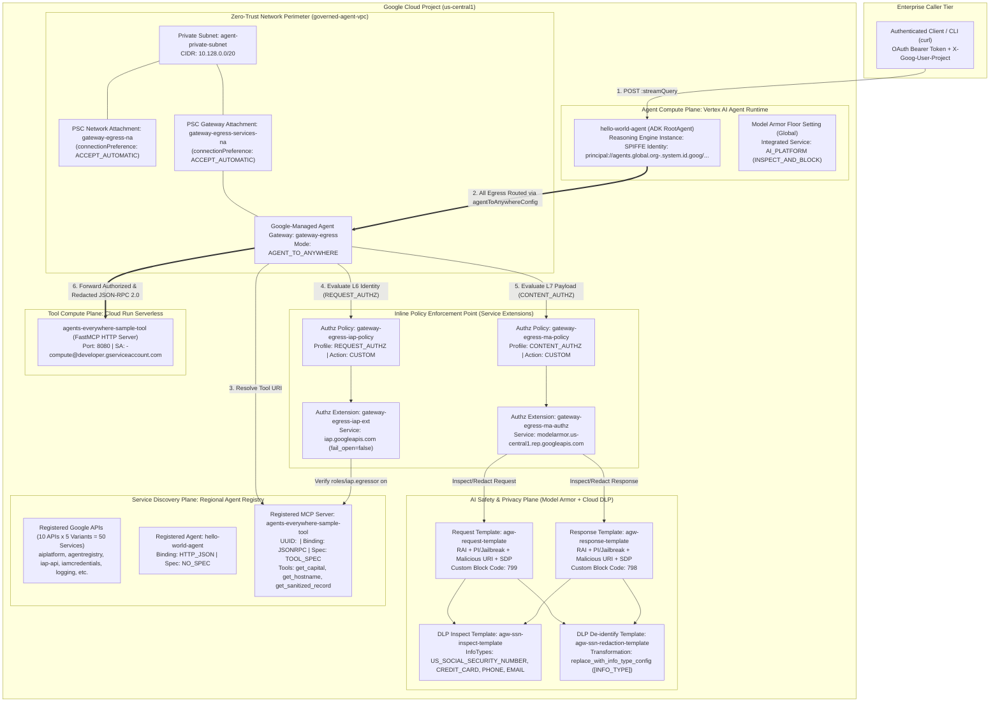
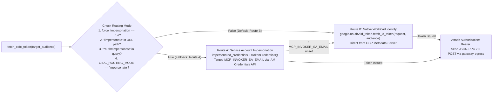
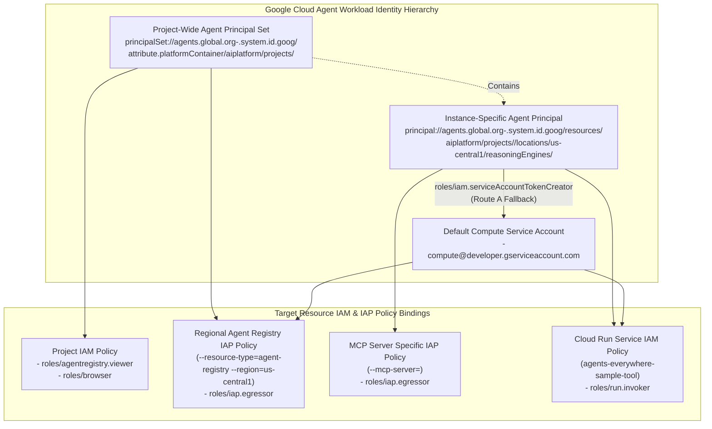

# High-Level Design (HLD): Enterprise Agent Governance on Google Cloud

[-34A853)](https://cloud.google.com)
[-FBBC05)](https://cloud.google.com/iap)
[-EA4335)](https://cloud.google.com/security-command-center/docs/model-armor-overview)

---

## 1. Architectural Vision & Core Governance Principles

As Generative AI agents evolve from passive chat interfaces into autonomous systems that invoke enterprise tools and query sensitive data stores via the **Model Context Protocol (MCP)**, traditional perimeter security models break down. Static firewall rules cannot govern dynamic agent-to-tool resolution, and network-layer controls alone are blind to application-layer threats such as **adversarial prompt injection** and **sensitive data leakage (PII/SPII)**.

The **Enterprise Agent Governance Platform** for **Cymbal Group** establishes a defense-in-depth **Zero-Trust Execution Perimeter** around an ADK agent (`hello-world-agent` on **Vertex AI Agent Runtime**) communicating with a serverless MCP microservice (`agents-everywhere-sample-tool` on **Cloud Run**). It is built on five core architectural principles:

1. **Governed Egress Perimeter (`AGENT_TO_ANYWHERE` Agent Gateway)**: All outbound agent traffic—including tool discovery, Google API calls, and MCP tool invocations—is routed through a regional Google-managed **Agent Gateway** (`gateway-egress`) backed by Private Service Connect (PSC) network attachments (`gateway-egress-na` and `gateway-egress-services-na`) inside an isolated VPC (`governed-agent-vpc`).
2. **Registry-Backed Service Discovery (Deny-by-Default Routing)**: The Agent Gateway is explicitly bound to the regional **Agent Registry** (`agentregistry.googleapis.com`). Only registered Google APIs (50 endpoint variants), registered agents (`hello-world-agent`), and registered MCP tool servers (`agents-everywhere-sample-tool` with explicit `TOOL_SPEC` schemas) are routable.
3. **Cryptographic Workload Identity & Inline Egress Authorization (`REQUEST_AUTHZ`)**: Every Reasoning Engine instance is provisioned with a native **SPIFFE Workload Identity** (`principal://agents.global.org-<ORG_ID>.system.id.goog/.../reasoningEngines/<INSTANCE_ID>`). The Agent Gateway delegates L6/L7 header authorization to **Identity-Aware Proxy (IAP)** via a Service Extension (`gateway-egress-iap-ext`), verifying `roles/iap.egressor` permissions on the specific target MCP Server UUID before any tool call leaves the perimeter.
4. **Inline AI Content Safety & PII De-identification (`CONTENT_AUTHZ`)**: The Agent Gateway streams JSON-RPC 2.0 request and response payloads to **Model Armor** (`modelarmor.us-central1.rep.googleapis.com`) integrated with **Cloud Data Loss Prevention (DLP)**. Prompt injection and jailbreak payloads are blocked inline at the gateway edge (`HTTP 403` / custom error code `799`), while sensitive records such as US Social Security Numbers (`555-01-9999`) are automatically redacted in-flight (`[US_SOCIAL_SECURITY_NUMBER]`) before reaching the downstream tool.
5. **Progressive Policy Enforcement (`DRY_RUN` $\rightarrow$ Active Blocking)**: Infrastructure is deployed with decoupled policy switches (`enable_iap_enforcement` and `enable_model_armor`), enabling safe baseline provisioning and discovery in audit (`DRY_RUN`) mode before transitioning the perimeter into strict zero-trust blocking mode.

---

## 2. System Context & Zero-Trust Topology

---

## 3. OSI 7-Layer Model Mapping for Agent Governance

A core architectural concept of this lab is mapping agent governance controls across the **OSI 7-Layer Model**, demonstrating how network, identity, discovery, and AI safety controls work together as an integrated stack:

| OSI Layer | Layer Name | Governance Domain | Google Cloud Implementation | Threat Mitigated |
| :--- | :--- | :--- | :--- | :--- |
| **Layer 7** | **Application Layer** | Inline AI Content Safety, Prompt Injection Defense & PII Redaction | **Model Armor** (`agw-request-template`, `agw-response-template`) + **Cloud DLP** (`agw-ssn-inspect-template`, `agw-ssn-redaction-template`) via `CONTENT_AUTHZ` Service Extension + MCP `TOOL_SPEC` JSON-RPC 2.0 schema validation | Adversarial prompt injection, jailbreaks, malicious URIs, toxic output, and plaintext PII/SSN exfiltration (`555-01-9999` $\rightarrow$ `[US_SOCIAL_SECURITY_NUMBER]`). |
| **Layer 6** | **Presentation & Identity Layer** | Cryptographic Workload Authentication & Zero-Trust Egress Authorization | **SPIFFE Workload Identity** (`principal://agents.global.org-...`), OIDC ID Tokens, and **Identity-Aware Proxy (IAP)** via `REQUEST_AUTHZ` Service Extension (`gateway-egress-iap-ext`) | Unauthorized agent-to-tool execution, credential spoofing, confused deputy attacks, and unauthenticated lateral movement. |
| **Layer 5** | **Session & Discovery Layer** | Governed Service Resolution & Capability Binding | **Regional Agent Registry** (`agentregistry.googleapis.com`) bound to `gateway-egress` (`registries` attribute) | Shadow MCP servers, rogue tool endpoints, and unapproved external API connections. |
| **Layer 4** | **Transport Layer** | Managed Regional Proxying & Connection Termination | **Agent Gateway (`gateway-egress`)** in `AGENT_TO_ANYWHERE` mode + Regional Internal Envoy/Load Balancer termination (`timeout = 3s`, `fail_open = false`) | Uninspected direct TCP/TLS streams bypassing policy enforcement points. |
| **Layer 3** | **Network Layer** | Isolated VPC Perimeter & Private Service Connect (PSC) | Custom VPC (`governed-agent-vpc`), Private Subnet (`agent-private-subnet`, `10.128.0.0/20`), PSC Network Attachments (`gateway-egress-na`, `gateway-egress-services-na` with `ACCEPT_AUTOMATIC`) | Public internet exposure, IP range exhaustion, and cross-VPC routing leaks. |
| **Layer 1 / 2** | **Physical & Data Link Layers** | Google Production Infrastructure | Google Cloud Andromeda SDN & Titanium hardware security | Physical/hypervisor interception and unauthorized link-local snooping. |

---

## 4. Dual Routing Architecture: Route B (Native Identity) vs. Route A (Impersonation)

When `hello-world-agent` invokes `agents-everywhere-sample-tool` over HTTPS, it must attach an `Authorization: Bearer <OIDC_ID_TOKEN>` header accepted by **both** the Agent Gateway's IAP `REQUEST_AUTHZ` extension and the downstream Cloud Run IAM invoker check.

The agent implementation (`agents/hello_agent/app/agent.py`) supports a **Dual OIDC Routing Architecture** inside `fetch_oidc_token(target_audience, force_impersonation)`:

### Architectural Comparison: Route B vs. Route A

| Dimension | Route B — Native Workload Identity (Default) | Route A — Service Account Impersonation (Fallback) |
| :--- | :--- | :--- |
| **Activation Condition** | Default runtime path when no impersonation flags are set | `/impersonate` in URL path, `auth=impersonate` query param, or `OIDC_ROUTING_MODE=impersonate` |
| **Caller Identity Principal** | `principal://agents.global.org-<ORG_ID>.system.id.goog/resources/aiplatform/projects/<PROJECT_NUMBER>/locations/us-central1/reasoningEngines/<INSTANCE_ID>` | `serviceAccount:<PROJECT_NUMBER>-compute@developer.gserviceaccount.com` |
| **Token Acquisition API** | Local Metadata Server (`google.oauth2.id_token.fetch_id_token`) | IAM Credentials API (`iamcredentials.googleapis.com` via `impersonated_credentials.IDTokenCredentials`) |
| **Required Agent Runtime Env Vars** | `GOOGLE_API_ENABLE_RUNTIME_BOUND_TOKEN="false"` `GOOGLE_API_PREVENT_AGENT_TOKEN_SHARING_FOR_GCP_SERVICES="false"` | `MCP_INVOKER_SA_EMAIL="<PROJECT_NUMBER>-compute@developer.gserviceaccount.com"` |
| **IAP Egressor Binding** | Bound directly to the Reasoning Engine `principal://...` on `--mcp-server=<MCP_SERVER_UUID>` | Bound to `serviceAccount:<PROJECT_NUMBER>-compute@...` on the regional Agent Registry |
| **Cloud Run Invoker Binding** | `roles/run.invoker` granted to the Reasoning Engine `principal://...` | `roles/run.invoker` granted to `serviceAccount:<PROJECT_NUMBER>-compute@...` |
| **Impersonation Prerequisite** | None (Zero shared service account identity) | Reasoning Engine `principal://...` requires `roles/iam.serviceAccountTokenCreator` on the target Compute Service Account |
| **Security Posture** | **Highest (Per-Agent Zero-Trust Identity)**: Every individual agent instance has a distinct cryptographic identity in audit logs and IAP policies. | **Transitional / Compatibility**: Useful when downstream targets do not yet support federated `principal://` bindings directly. |

---

## 5. Security, Identity & Policy Enforcement Architecture

### 5.1 Two-Tier Workload Identity Design
1. **Project-Scoped Principal Set (`principalSet://...`)**:
   - Represents all Vertex AI Agent Runtime reasoning engines running within the project (`attribute.platformContainer/aiplatform/projects/${PROJECT_NUMBER}`).
   - Granted broad discovery and baseline egress permissions:
     - `roles/browser` and `roles/agentregistry.viewer` at the project level so any agent container can initialize the Vertex AI SDK and query the Agent Registry.
     - `roles/iap.egressor` at the regional Agent Registry level so agents can reach core Google APIs (`aiplatform`, `logging`, `oauth2`, `agentregistry`, etc.).
2. **Instance-Scoped Principal (`principal://...`)**:
   - Represents a single deployed Reasoning Engine instance (`.../reasoningEngines/${INSTANCE_ID}`).
   - Granted least-privilege tool execution permissions in Task 4:
     - `roles/iap.egressor` scoped strictly to the individual MCP server resource (`--mcp-server=${MCP_SERVER_UUID}`).
     - `roles/run.invoker` scoped strictly to the `agents-everywhere-sample-tool` Cloud Run service.
     - `roles/iam.serviceAccountTokenCreator` on `${PROJECT_NUMBER}-compute@developer.gserviceaccount.com` for Route A fallback.

### 5.2 Defense-in-Depth Content Safety Architecture
Content safety is enforced at two complementary layers:
1. **Platform Floor Setting (`google_model_armor_floorsetting.vertex_ai_floor_setting`)**:
   - Configured globally on the project with `integrated_services = ["AI_PLATFORM"]` and `inspect_and_block = true`.
   - Protects direct Vertex AI model calls against Hate Speech, Harassment, Sexually Explicit content, Dangerous content, Prompt Injection/Jailbreaks (`MEDIUM_AND_ABOVE`), and Malicious URIs.
2. **Gateway Edge Service Extension (`gateway-egress-ma-authz` + `gateway-egress-ma-policy`)**:
   - Configured regionally on `gateway-egress` using the `CONTENT_AUTHZ` policy profile.
   - Invokes `modelarmor.us-central1.rep.googleapis.com` with `agw-request-template` (on outbound tool requests) and `agw-response-template` (on inbound tool responses).
   - Chains **Advanced Sensitive Data Protection (SDP)** directly into the gateway pipeline by linking `agw-ssn-inspect-template` (detecting `US_SOCIAL_SECURITY_NUMBER`, `CREDIT_CARD_NUMBER`, `PHONE_NUMBER`, `EMAIL_ADDRESS` at `min_likelihood = "POSSIBLE"`) with `agw-ssn-redaction-template` (replacing matched values in-place with `[INFO_TYPE]` surrogate tags such as `[US_SOCIAL_SECURITY_NUMBER]`).

---

## 6. Component & Compute Matrix

| Component | Resource Name / ID | Compute / Service Plane | Protocol / Binding | Security Control Role |
| :--- | :--- | :--- | :--- | :--- |
| **VPC Network** | `governed-agent-vpc` | Compute Engine VPC (`global`) | Layer 3 Custom VPC (`auto_create_subnetworks=false`) | Isolates agent egress network topology. |
| **Private Subnet** | `agent-private-subnet` | Compute Engine Subnetwork (`us-central1`) | `10.128.0.0/20` | Hosts PSC network attachments for gateway egress. |
| **PSC Network Attachments** | `gateway-egress-na` `gateway-egress-services-na` | Compute Engine PSC (`us-central1`) | `ACCEPT_AUTOMATIC` | Bridges Google-managed Agent Runtime/Gateway tenant networks into customer VPC. |
| **Agent Gateway** | `gateway-egress` | Network Services (`us-central1`) | `AGENT_TO_ANYWHERE` | Central Zero-Trust Policy Enforcement Point (PEP) for all outbound agent traffic. |
| **IAP Authz Extension & Policy** | `gateway-egress-iap-ext` `gateway-egress-iap-policy` | Network Services / Security (`us-central1`) | `REQUEST_AUTHZ` $\rightarrow$ `iap.googleapis.com` | Verifies SPIFFE OIDC tokens and `roles/iap.egressor` (`DRY_RUN` in Task 2 $\rightarrow$ Active in Task 4). |
| **Model Armor Extension & Policy** | `gateway-egress-ma-authz` `gateway-egress-ma-policy` | Network Services / Security (`us-central1`) | `CONTENT_AUTHZ` $\rightarrow$ `modelarmor.us-central1.rep.googleapis.com` | Streams JSON-RPC request/response bodies for inline PI blocking & DLP redaction (Task 6). |
| **Model Armor Templates** | `agw-request-template` `agw-response-template` | Model Armor (`us-central1`) | Regional REP API (`v1alpha`) | Defines RAI, PI/Jailbreak, Malicious URI, and SDP rules (`799` request / `798` response codes). |
| **Cloud DLP Templates** | `agw-ssn-inspect-template` `agw-ssn-redaction-template` | Sensitive Data Protection (`us-central1`) | DLP v2 Templates | Detects SSN/PII (`POSSIBLE`) and replaces with `[US_SOCIAL_SECURITY_NUMBER]`. |
| **Agent Registry** | Regional Registry (`us-central1`) | Agent Registry (`v1alpha`) | `JSONRPC` (`TOOL_SPEC`) & `HTTP_JSON` (`NO_SPEC`) | Source of truth for discoverable endpoints, agents, MCP servers, and IAP resources. |
| **ADK Agent Runtime** | `hello-world-agent` (`<INSTANCE_ID>`) | Vertex AI Agent Runtime (`us-central1`) | `:query` / `:streamQuery` (`HTTP_JSON`) | Orchestrates tool discovery, OIDC token acquisition, and MCP tool invocation. |
| **MCP Tool Server** | `agents-everywhere-sample-tool` | Cloud Run (`us-central1`) | FastMCP over HTTP POST (`JSONRPC` 2.0) | Executes `get_capital`, `get_hostname`, and `get_santized_record`. |
