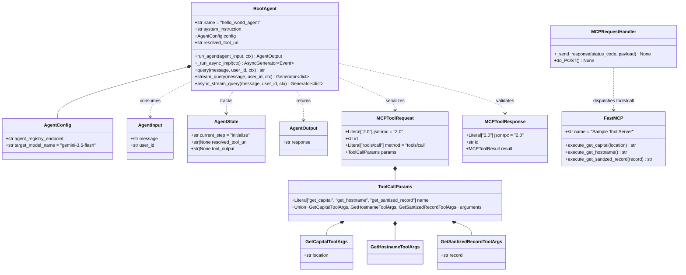

# Low-Level Design (LLD): Module, Class, Schema, and Terraform Specification

---

## 1. Repository & Package Structure

```text
enterprise-agent-governance-runbook/
├── README.md                                  # Landing Page, Architecture Overview & Quick Runbook
├── RUNBOOK.md                                 # Complete Step-by-Step Operational Runbook (Tasks 1–8)
├── HIGH_LEVEL_DESIGN.md                       # High-Level Design (Topology, OSI 7-Layer, Route B vs A)
├── LOW_LEVEL_DESIGN.md                        # Low-Level Design (Terraform Modules, Classes, Schemas)
├── WORKFLOW.md                                # End-to-End Sequence Diagrams, State Machines & Flows
├── ARCHITECTURE_AND_DESIGN.md                 # Unified Architecture & Engineering Reference
├── Enterprise_Agent_Governance_Runbook_HLD_LLD_Workflow.docx # Standalone Word Document
├── agents/
│   └── hello_agent/                           # Google ADK Agent (Vertex AI Agent Runtime)
│       ├── agents-cli-manifest.yaml           # agents-cli 0.6.1 deployment manifest
│       ├── Dockerfile                         # Python 3.13-slim container image definition
│       ├── pyproject.toml                     # Package metadata & dependencies
│       ├── requirements.txt                   # Pinned runtime dependencies
│       ├── app/
│       │   ├── agent.py                       # RootAgent, resolve_tool_uri, fetch_oidc_token, retry
│       │   ├── agent_runtime_app.py           # Entrypoint exporting main.adk_app as agent_runtime
│       │   ├── main.py                        # FastAPI wrapper (/api/reasoning_engine & streaming)
│       │   └── models.py                      # Pydantic schemas (AgentInput, MCPToolRequest, etc.)
│       └── tests/                             # Unit test suite (test_agent, test_hello_models, test_main)
├── mcp-servers/
│   └── sample-tool/                           # Serverless MCP Tool Microservice (Cloud Run)
│       ├── Dockerfile                         # Python 3.12-slim container image definition
│       ├── models.py                          # Pydantic JSON-RPC 2.0 & One MCP schemas
│       ├── pyproject.toml                     # Package metadata
│       ├── requirements.txt                   # FastMCP & Pydantic dependencies
│       ├── server.py                          # FastMCP tools + BaseHTTPRequestHandler JSON-RPC server
│       └── tests/                             # Unit test suite (test_sample_models, test_server)
├── scripts/
│   └── lab-cleanup.sh                         # Ordered teardown script (ReasoningEngines -> Policies -> Gateways)
└── terraform/                                 # Modular Infrastructure-as-Code (IaC)
    ├── main.tf                                # Root orchestrator, variables, Artifact Registry & core IAM
    ├── networking/
    │   ├── main.tf                            # VPC, Subnet (10.128.0.0/20), PSC Attachment (gateway-egress-na)
    │   ├── outputs.tf                         # Exports vpc_id, private_subnet_id, network_attachment_id
    │   └── variables.tf                       # Networking input variables
    ├── registry/
    │   ├── main.tf                            # Enables agentregistry API, IAP bindings, 50 Google API endpoints
    │   └── scripts/
    │       └── register_endpoints.sh.tpl      # Template script registering 10 Google APIs x 5 variants
    ├── gateway/
    │   ├── main.tf                            # Agent Gateway, IAP REQUEST_AUTHZ, Model Armor CONTENT_AUTHZ
    │   └── variables.tf                       # Gateway & policy toggle input variables
    └── model-armor/
        ├── main.tf                            # Cloud DLP templates, Vertex AI Floor Setting, Model Armor templates
        ├── outputs.tf                         # Exports template IDs & service agent emails
        └── variables.tf                       # Model Armor & PII info_types input variables
```

---

## 2. Application Class & Schema Diagram



---

## 3. Terraform Module Specifications (`terraform/`)

### 3.1 Root Module (`terraform/main.tf`)
The root module configures the `google` and `google-beta` providers (`>= 5.0`) with `user_project_override = true` and `billing_project = var.project_id` (required for Cloud DLP and Model Armor quota attribution).

#### Root Input Variables & Policy Switches

| Variable Name | Type | Default | Task 2 Value | Task 4 Value | Task 6 Value | Purpose |
| :--- | :--- | :--- | :--- | :--- | :--- | :--- |
| `project_id` | `string` | `"project-id-change-me"` | `${PROJECT_ID}` | `${PROJECT_ID}` | `${PROJECT_ID}` | Target GCP Project ID. |
| `project_number` | `string` | `"500797570986"` | `${PROJECT_NUMBER}` | `${PROJECT_NUMBER}` | `${PROJECT_NUMBER}` | Target GCP Project Number. |
| `region` | `string` | `"us-central1"` | `us-central1` | `us-central1` | `us-central1` | Deployment region. |
| `organization_id` | `string` | *(required)* | `${ORGANIZATION_ID}` | `${ORGANIZATION_ID}` | `${ORGANIZATION_ID}` | GCP Organization ID for SPIFFE principal domain (`agents.global.org-<ORG_ID>.system.id.goog`). |
| `enable_iap_enforcement` | `bool` | `false` | **`false`** (`DRY_RUN`) | **`true`** (Active) | **`true`** (Active) | Controls `iamEnforcementMode` on `gateway-egress-iap-ext`. |
| `enable_model_armor` | `bool` | `false` | **`false`** | **`false`** | **`true`** | Enables Cloud DLP templates, Model Armor templates, and `CONTENT_AUTHZ` gateway binding. |
| `agent_gateway_name` | `string` | `"gateway-egress"` | `gateway-egress` | `gateway-egress` | `gateway-egress` | Name of the regional `AGENT_TO_ANYWHERE` Agent Gateway. |
| `vpc_network_name` | `string` | `"governed-agent-vpc"` | `governed-agent-vpc` | `governed-agent-vpc` | `governed-agent-vpc` | Custom VPC network name. |
| `subnet_name` | `string` | `"agent-private-subnet"` | `agent-private-subnet` | `agent-private-subnet` | `agent-private-subnet` | Private subnet name (`10.128.0.0/20`). |
| `network_attachment_name` | `string` | `"gateway-egress-na"` | `gateway-egress-na` | `gateway-egress-na` | `gateway-egress-na` | Base PSC network attachment verified in Task 2. |
| `model_armor_request_template_id` | `string` | `null` | `agw-request-template` | `agw-request-template` | `agw-request-template` | Request inspection template ID. |
| `model_armor_response_template_id` | `string` | `null` | `agw-response-template` | `agw-response-template` | `agw-response-template` | Response inspection template ID. |
| `model_armor_inspect_template_id` | `string` | `null` | `agw-ssn-inspect-template` | `agw-ssn-inspect-template` | `agw-ssn-inspect-template` | Cloud DLP inspect template ID. |
| `model_armor_deidentify_template_id` | `string` | `null` | `agw-ssn-redaction-template` | `agw-ssn-redaction-template` | `agw-ssn-redaction-template` | Cloud DLP de-identify template ID. |
| `enable_vertex_ai_integration` | `bool` | `true` | `true` | `true` | `true` | Enables global Vertex AI Model Armor Floor Setting. |
| `vertex_ai_inspect_only` | `bool` | `false` | `false` | `false` | `false` | Sets Floor Setting to `inspect_and_block = true`. |

#### Root Resources Provisioned Directly in `terraform/main.tf`
- `google_artifact_registry_repository.agent_repo`: Docker repository (`agent-repo`) in `us-central1`.
- `google_project_iam_member.aiplatform_network_admin`: Grants `roles/compute.networkAdmin` to `service-${project_number}@gcp-sa-aiplatform.iam.gserviceaccount.com`.
- `google_project_iam_member.aiplatform_re_network_admin`: Grants `roles/compute.networkAdmin` to `service-${project_number}@gcp-sa-aiplatform-re.iam.gserviceaccount.com`.
- `google_project_iam_member.agent_identity_agentregistry_viewer`: Grants `roles/agentregistry.viewer` to `principalSet://agents.global.org-${organization_id}.system.id.goog/attribute.platformContainer/aiplatform/projects/${project_number}`.
- `google_project_iam_member.agent_identity_browser`: Grants `roles/browser` to the same `principalSet://...` (required for Vertex AI SDK initialization inside the Reasoning Engine container).
- `google_project_iam_member.aiplatform_re_token_creator`: Grants `roles/iam.serviceAccountTokenCreator` to `service-${project_number}@gcp-sa-aiplatform-re.iam.gserviceaccount.com`.

---

### 3.2 Networking Module (`terraform/networking/main.tf`)
Provisions the isolated L3/L4 perimeter:
1. `google_compute_network.vpc`:
   - `name = var.vpc_network_name` (`governed-agent-vpc`)
   - `auto_create_subnetworks = false`
2. `google_compute_subnetwork.private_subnet`:
   - `name = var.subnet_name` (`agent-private-subnet`)
   - `ip_cidr_range = "10.128.0.0/20"`
   - `region = var.region` (`us-central1`)
3. `google_compute_network_attachment.gateway_egress_na`:
   - `name = var.network_attachment_name` (`gateway-egress-na`)
   - `connection_preference = "ACCEPT_AUTOMATIC"`
   - `subnetworks = [google_compute_subnetwork.private_subnet.id]`

---

### 3.3 Registry Module (`terraform/registry/main.tf` & `scripts/register_endpoints.sh.tpl`)
1. **API Enablement (`google_project_service.agent_registry_api`)**: Enables `agentregistry.googleapis.com`.
2. **Serialized Regional IAP Egressor Bindings**:
   To prevent concurrent `setIamPolicy` race conditions on the regional `agent-registry` IAP resource, three `null_resource` blocks execute sequentially via explicit `depends_on` chains:
   - `agent_registry_egressor_binding` $\rightarrow$ grants `roles/iap.egressor` to `principalSet://agents.global.org-${organization_id}.system.id.goog/attribute.platformContainer/aiplatform/projects/${project_number}`.
   - `compute_sa_egressor_binding` $\rightarrow$ grants `roles/iap.egressor` to `serviceAccount:${project_number}-compute@developer.gserviceaccount.com`.
   - `aiplatform_sa_egressor_binding` $\rightarrow$ grants `roles/iap.egressor` to `serviceAccount:service-${project_number}@gcp-sa-aiplatform-re.iam.gserviceaccount.com`.
3. **Bulk Google API Registration (`null_resource.register_google_apis`)**:
   Executes `scripts/register_endpoints.sh.tpl` to register **10 core Google APIs**:
   `aiplatform`, `cloudresourcemanager`, `logging`, `monitoring`, `oauth2`, `agentregistry`, `iap-api`, `iamcredentials`, `telemetry`, `trace`.
   For each API (`${id}`), it registers **5 endpoint variants** (totaling **50 services**) with `--endpoint-spec-type=no-spec` and `protocolBinding=JSONRPC`:
   - `${id}` $\rightarrow$ `https://${id}.googleapis.com`
   - `${id}-mtls` $\rightarrow$ `https://${id}.mtls.googleapis.com`
   - `${LOCATION}-${id}` $\rightarrow$ `https://${LOCATION}-${id}.googleapis.com`
   - `${LOCATION}-${id}-mtls` $\rightarrow$ `https://${LOCATION}-${id}.mtls.googleapis.com`
   - `${id}-${LOCATION}-rep` $\rightarrow$ `https://${id}.${LOCATION}.rep.googleapis.com`

---

### 3.4 Gateway Module (`terraform/gateway/main.tf`)
Provisions the regional Agent Gateway and binds the inline authorization policies:

1. **`google_compute_network_attachment.agent_gateway`**:
   - Name: `${var.agent_gateway_name}-services-na` (`gateway-egress-services-na`)
   - `connection_preference = "ACCEPT_AUTOMATIC"`, attached to `agent-private-subnet`.
2. **`google_network_services_agent_gateway.agent_gateway`**:
   - Name: `gateway-egress` (`location = "us-central1"`)
   - `google_managed { governed_access_path = "AGENT_TO_ANYWHERE" }`
   - `registries = ["//agentregistry.googleapis.com/projects/${var.project_id}/locations/${var.region}"]`
   - `network_config { egress { network_attachment = google_compute_network_attachment.agent_gateway.id } }`
3. **`time_sleep.wait_for_gateway`**:
   - Waits `30s` after gateway creation so the internal Envoy/load-balancer control plane stabilizes before attaching `google_network_security_authz_policy` resources.
4. **IAP `REQUEST_AUTHZ` Extension & Policy**:
   - `google_network_services_authz_extension.iap_authz_extension`:
     - Name: `gateway-egress-iap-ext`
     - `service = "iap.googleapis.com"`, `timeout = "3s"`, `fail_open = false`
     - `forward_headers = ["Authorization", "X-Goog-User-Project"]`
     - `metadata = { iapPolicyVersion = "V1", iamEnforcementMode = var.enable_iap_enforcement ? null : "DRY_RUN" }`
   - `google_network_security_authz_policy.egress_authz_policy`:
     - Name: `gateway-egress-iap-policy`
     - `policy_profile = "REQUEST_AUTHZ"`, `action = "CUSTOM"`
     - Targets `gateway-egress` and delegates to `gateway-egress-iap-ext`.
5. **Model Armor `CONTENT_AUTHZ` Extension & Policy (Conditional on `var.enable_model_armor`)**:
   - `google_network_services_authz_extension.model_armor[0]`:
     - Name: `gateway-egress-ma-authz`
     - `service = "modelarmor.${var.region}.rep.googleapis.com"`, `timeout = "3s"`
     - Passes `request_template_id` (`agw-request-template`) and `response_template_id` (`agw-response-template`) inside JSON-encoded `metadata["model_armor_settings"]`.
   - `google_network_security_authz_policy.model_armor[0]`:
     - Name: `gateway-egress-ma-policy`
     - `policy_profile = "CONTENT_AUTHZ"`, `action = "CUSTOM"`
     - Targets `gateway-egress` and delegates body inspection to `gateway-egress-ma-authz`.
   - `google_project_iam_member.service_extensions_sa`:
     - Dynamically reads `agent_gateway.agent_gateway_card[0].service_extensions_service_account` and grants `roles/modelarmor.calloutUser`, `roles/serviceusage.serviceUsageConsumer`, and `roles/modelarmor.user`.

---

### 3.5 Model Armor & Cloud DLP Module (`terraform/model-armor/main.tf`)
When `enable_model_armor = true` (Task 6), this module provisions 15 resources:
1. **APIs & Service Identity**:
   - Enables `dlp.googleapis.com` and `modelarmor.googleapis.com`.
   - Creates `google_project_service_identity.model_armor` (`service-${PROJECT_NUMBER}@gcp-sa-modelarmor.iam.gserviceaccount.com`) and grants it `roles/dlp.user` and `roles/dlp.reader`.
   - Grants `service-${PROJECT_NUMBER}@gcp-sa-dep.iam.gserviceaccount.com` (Service Extensions service agent) `roles/container.admin`, `roles/modelarmor.calloutUser`, `roles/serviceusage.serviceUsageConsumer`, and `roles/modelarmor.user`.
   - Grants `service-${PROJECT_NUMBER}@gcp-sa-aiplatform.iam.gserviceaccount.com` `roles/modelarmor.user`.
2. **Cloud DLP Templates (`us-central1`)**:
   - `google_data_loss_prevention_inspect_template.ssn` (`agw-ssn-inspect-template`):
     - Inspects `info_types = ["US_SOCIAL_SECURITY_NUMBER", "CREDIT_CARD_NUMBER", "PHONE_NUMBER", "EMAIL_ADDRESS"]` with `min_likelihood = "POSSIBLE"`.
   - `google_data_loss_prevention_deidentify_template.ssn` (`agw-ssn-redaction-template`):
     - Applies `primitive_transformation { replace_with_info_type_config = true }` across those 4 `info_types`, replacing any match with `[US_SOCIAL_SECURITY_NUMBER]`, `[CREDIT_CARD_NUMBER]`, etc.
3. **Global Vertex AI Floor Setting (`google_model_armor_floorsetting.vertex_ai_floor_setting`)**:
   - `parent = "projects/${var.project_id}"`, `location = "global"`, `integrated_services = ["AI_PLATFORM"]`.
   - Enforces `inspect_and_block = true` with `enable_cloud_logging = true`.
4. **Regional Model Armor Templates (`agw-request-template` & `agw-response-template`)**:
   - Both configure:
     - `rai_settings`: `HATE_SPEECH`, `HARASSMENT`, `SEXUALLY_EXPLICIT`, `DANGEROUS` at `MEDIUM_AND_ABOVE`.
     - `pi_and_jailbreak_filter_settings`: `ENABLED` at `MEDIUM_AND_ABOVE`.
     - `malicious_uri_filter_settings`: `ENABLED`.
     - `sdp_settings.advanced_config`: Links `agw-ssn-inspect-template` and `agw-ssn-redaction-template`.
   - `agw-request-template` metadata:
     - `custom_prompt_safety_error_code = 799`
     - `custom_prompt_safety_error_message = "Your request was blocked by our content filter. Please rephrase and try again."`
   - `agw-response-template` metadata:
     - `custom_llm_response_safety_error_code = 798`
     - `custom_llm_response_safety_error_message = "LLM response blocked by content filter"`

---

## 4. Component Specification: ADK Agent (`agents/hello_agent/`)

### 4.1 `app/models.py` — Pydantic Data Contracts
Defines strict Pydantic v2 models for the agent reasoning loop and MCP JSON-RPC 2.0 wire format:
- `AgentInput(message: str, user_id: str)`
- `AgentState(current_step: str = "initialize", resolved_tool_uri: str | None = None, tool_output: str | None = None)`
- `GetCapitalToolArgs(location: str)`
- `GetHostnameToolArgs()`
- `GetSantizedRecordToolArgs(record: str)`
- `ToolCallParams(name: Literal["get_capital", "get_hostname", "get_santized_record"], arguments: Union[...])`
- `MCPToolRequest(jsonrpc: Literal["2.0"] = "2.0", id: str, method: Literal["tools/call"] = "tools/call", params: ToolCallParams)`
- `MCPToolResponse(jsonrpc: Literal["2.0"] = "2.0", id: str, result: MCPToolResult)`
- `AgentOutput(response: str)`

### 4.2 `app/agent.py` — Discovery, Token Acquisition, and Reasoning Loop
1. **`resolve_tool_uri(registry_endpoint: str, tool_name: str) -> str`**:
   - Attaches `X-Goog-User-Project: <PROJECT_ID>` and `Authorization: Bearer <GOOGLE_OAUTH_ACCESS_TOKEN>` (via `fetch_google_access_token()`).
   - **Primary Discovery Path**: Queries `GET {registry_endpoint}/mcpServers` and matches `displayName == tool_name` or resource suffix `== tool_name`, returning `item["interfaces"][0]["url"]`. Using `/mcpServers` ensures compatibility with IAP active blocking on MCP server resources.
   - **Fallback Path**: Queries `GET {registry_endpoint}/services/{tool_name}`.
2. **`fetch_oidc_token(target_audience: str, force_impersonation: Optional[bool] = None) -> str`**:
   - Extracts `audience = f"{parsed.scheme}://{parsed.netloc}"`.
   - Evaluates whether Route A (impersonation) is requested (`force_impersonation`, `/impersonate` in path, `auth=impersonate` in query, or `OIDC_ROUTING_MODE=impersonate`).
   - **Route B (`_try_native`)**: Calls `google.oauth2.id_token.fetch_id_token(request, audience)` against the local GCP metadata server.
   - **Route A (`_try_impersonation`)**: Reads `MCP_INVOKER_SA_EMAIL` and uses `google.auth.impersonated_credentials.IDTokenCredentials` to mint an OIDC token for `audience`.
3. **`call_http_with_retry(url, payload, headers, max_retries=3, timeout=10) -> str`**:
   - Sends HTTP `POST` with exponential backoff (`1.0s`, `2.0s`, `4.0s`).
   - **Fast-Fail on Security Intervention**: Immediately re-raises `urllib.error.HTTPError` if `e.code in (403, 798, 799)` without retrying, because a `403` / `798` / `799` status indicates an active IAP or Model Armor block.
4. **`RootAgent.run_agent(agent_input, ctx, **kwargs) -> AgentOutput`**:
   - Resolves `agents-everywhere-sample-tool` URI from the Agent Registry.
   - Routes user intent deterministically to one of the three MCP tools:
     - `"hostname" in msg_lower` $\rightarrow$ `get_hostname` (`GetHostnameToolArgs()`)
     - `"social security" in msg_lower` or `"ssn" in msg_lower` or `"123-45-" in msg_lower` $\rightarrow$ `get_santized_record` (`GetSantizedRecordToolArgs(record=target_location)`)
     - Otherwise $\rightarrow$ `get_capital` (`GetCapitalToolArgs(location=target_location)`)
   - Builds `MCPToolRequest(id="reasoning-step-1", params=params)` and sends it with `Authorization: Bearer <OIDC_TOKEN>`.
   - If `HTTPError` with code `403`, `798`, or `799` is caught, returns:
     `AgentOutput(response=f"Content Safety Intervention (HTTP {e.code}): {err_msg}")`.
   - On `200 OK`, parses `MCPToolResponse` and returns:
     `AgentOutput(response=f"Reasoning Engine ({self.config.target_model_name}) synthesis: {output_text}")`.

### 4.3 `app/main.py` & `app/agent_runtime_app.py` — Container & Reasoning Engine Entrypoints
- Wraps `root_agent` in `vertexai.agent_engines.AdkApp` using `InMemorySessionService`.
- Overrides `adk_app.project_id = _safe_project_id` to prevent unrouted gRPC metadata lookups during container initialization inside the zero-trust perimeter.
- Exposes FastAPI endpoints `POST /api/reasoning_engine` (synchronous) and `POST /api/stream_reasoning_engine` (streaming NDJSON chunks).

---

## 5. Component Specification: Cloud Run MCP Server (`mcp-servers/sample-tool/`)

### 5.1 `server.py` — FastMCP Tool Registry & HTTP Handler
Initializes `mcp = FastMCP("Sample Tool Server")` and registers three tools:
1. **`@mcp.tool(name="get_capital")`**:
   - Input: `location: str`
   - Logic: Returns `{"capital": "Tokyo"}` if `"japan"` in `location.lower()`, `{"capital": "Paris"}` if `"france"` in `location.lower()`, else `{"capital": "Unknown"}`.
2. **`@mcp.tool(name="get_hostname")`**:
   - Input: `{}`
   - Logic: Returns `{"hostname": socket.gethostname()}`.
3. **`@mcp.tool(name="get_santized_record")`**:
   - Input: `record: str`
   - Logic: Echoes `{"santized_record": record}` (which contains the payload **after** Model Armor & Cloud DLP have redacted any SSNs inline at the Agent Gateway).

> **Important Schema vs. Implementation Note**:
> - In the **Agent Registry** (`Task 3`), the lab grading check requires registering the third capability in the `TOOL_SPEC` JSON as `"name": "get_sanitized_record"` (spelled with an `i`).
> - In the **Python implementation** (`agents/hello_agent/app/agent.py` line 382 and `mcp-servers/sample-tool/server.py` line 77), the wire-level JSON-RPC `tools/call` method name and response key use `"get_santized_record"` / `"santized_record"` (without the first `i`). Both files match each other so runtime execution succeeds seamlessly.

---

## 6. Component Specification: Resource Cleanup Script (`scripts/lab-cleanup.sh`)

Agent Gateways and Authorization Policies have strict referential integrity constraints in Google Cloud Network Services / Network Security. `scripts/lab-cleanup.sh` enforces a strict 3-phase deletion sequence:
1. **Phase 1 — Delete Reasoning Engines (`aiplatform.googleapis.com/v1`)**:
   Lists all Reasoning Engines in `us-central1` and issues `DELETE https://us-central1-aiplatform.googleapis.com/v1/{re}?force=true` so no active runtime holds references to `gateway-egress`.
2. **Phase 2 — Delete Network Security Authz Policies (`gcloud network-security authz-policies delete`)**:
   Enumerates and deletes `gateway-egress-ma-policy` and `gateway-egress-iap-policy`. **Why required first:** Google Cloud prevents deleting an `agentGateway` resource while any `authzPolicy` still references it in `target.resources`.
3. **Phase 3 — Delete Agent Gateways (`gcloud network-services agent-gateways delete`)**:
   Enumerates and deletes `gateway-egress` in `us-central1`, releasing the regional Agent Gateway quota.
